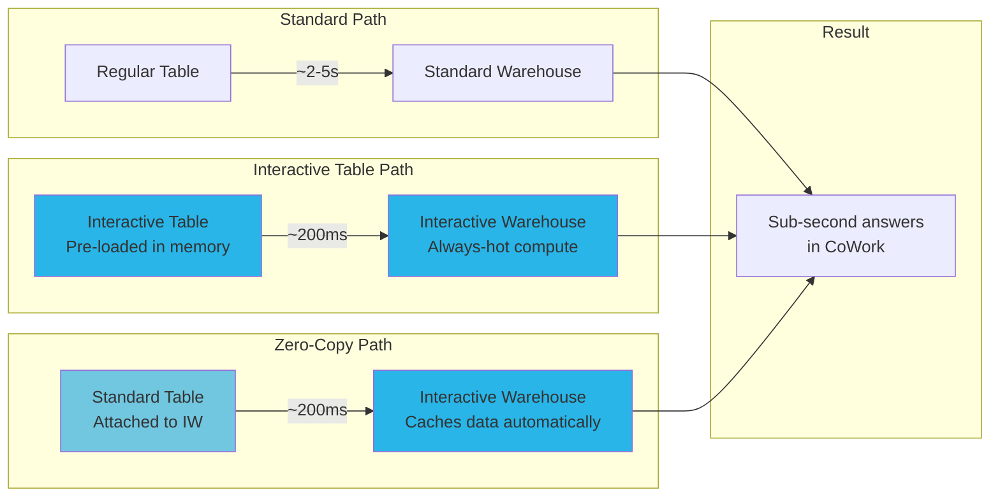
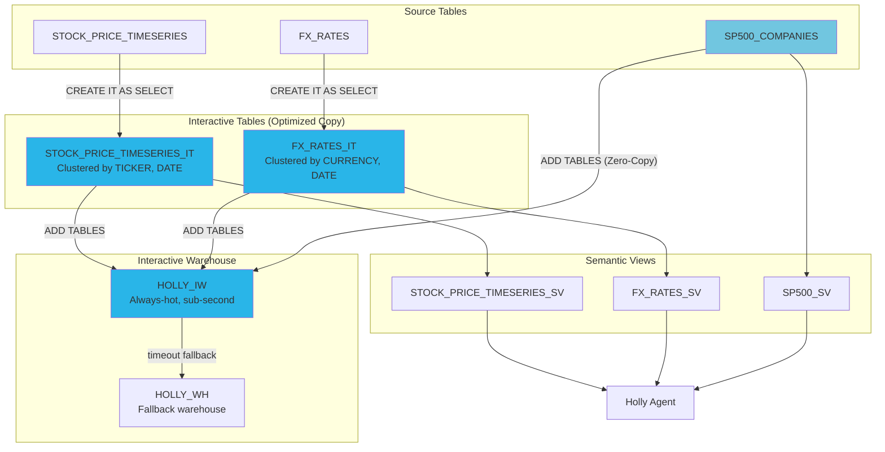

# Step 5: Interactive Tables & Warehouses

**Time: 10 minutes**

## What You'll Build

Convert stock price data to Interactive Tables served by an Interactive Warehouse for sub-second query response — making Holly's price lookups feel instant.



## What are Interactive Tables and Warehouses?

**Interactive Tables** are pre-materialized, memory-optimized tables that serve data at sub-second latency. They're ideal for:
- Dashboards and conversational AI where users expect instant responses
- Frequently queried datasets with known access patterns
- Time-series data used in charting and lookups

**Interactive Warehouses** are always-hot compute clusters that keep Interactive Tables loaded in memory. They include:
- Automatic fallback to a standard warehouse for queries that don't hit Interactive Tables
- No cold-start latency — always ready to serve

## Zero-Copy Interactive (New — Sep 2026)

As of September 2026, Interactive Warehouses can also query **standard tables and Iceberg tables directly** — no need to create Interactive Tables first. This is called [Zero-Copy Interactive](https://www.snowflake.com/en/blog/engineering/zero-copy-interactive-analytics/).

**How it works:**
- Attach any existing table to an Interactive Warehouse with `ALTER WAREHOUSE ... ADD TABLES`
- The IW automatically caches the data for sub-second queries
- Attaching is an optimization, not a prerequisite — any table can be queried through an IW

**When to use which:**

| Approach | Best For |
|----------|----------|
| **Interactive Tables** | Dedicated serving with pre-aggregation or specific projections |
| **Zero-Copy Interactive** | Quick low-latency access to existing tables without creating new objects |

This lab uses Interactive Tables for stock prices and FX rates (the primary serving path), and demonstrates Zero-Copy with SP500_COMPANIES as a simpler alternative.

## Instructions

Run `create_interactive.sql`. The script:

1. Creates an Interactive Table from stock price data (STOCK_PRICE_TIMESERIES_IT)
2. Creates an Interactive Warehouse (HOLLY_IW, MEDIUM size)
3. Sets a fallback warehouse for non-interactive queries
4. Attaches the Interactive Table to the Interactive Warehouse
5. Creates an FX rates Interactive Table (FX_RATES_IT) and attaches it
6. Updates semantic views to point to the Interactive Tables
7. Demonstrates Zero-Copy by attaching SP500_COMPANIES (a standard table) directly

### How the Pieces Fit Together



### What the Script Creates

| Object | Type | Purpose |
|--------|------|---------|
| STOCK_PRICE_TIMESERIES_IT | Interactive Table | ~5.5M rows of daily stock prices, clustered by ticker and date |
| FX_RATES_IT | Interactive Table | ~600K rows of FX rates, clustered by currency pair and date |
| HOLLY_IW | Interactive Warehouse | Always-hot compute for sub-second queries |
| HOLLY_WH | Standard Warehouse | Fallback for queries exceeding 5-second IW limit |
| STOCK_PRICE_TIMESERIES_SV | Semantic View | Updated to point at IT (was standard table) |
| FX_RATES_SV | Semantic View | Updated to point at IT (was standard table) |
| SP500_COMPANIES | Standard Table (attached) | Zero-Copy: attached to IW without creating an IT |

## Verify It Worked

```sql
-- Check Interactive Tables exist
SHOW INTERACTIVE TABLES IN SCHEMA HOLLY_DB.STRUCTURED;

-- Check Interactive Warehouse and see which tables are attached
SHOW WAREHOUSES LIKE 'HOLLY_IW';

-- Test Interactive Table query speed (should be <500ms)
SELECT TICKER, DATE, VALUE AS CLOSING_PRICE
FROM HOLLY_DB.STRUCTURED.STOCK_PRICE_TIMESERIES_IT
WHERE TICKER = 'NVDA' AND VARIABLE_NAME = 'Post-Market Close'
ORDER BY DATE DESC
LIMIT 5;

-- Test Zero-Copy query speed (standard table, no IT)
SELECT * FROM HOLLY_DB.STRUCTURED.SP500_COMPANIES WHERE SYMBOL = 'NVDA';
```

## Why Snowflake?

| Traditional Approach | Interactive Tables + Warehouses |
|---------------------|-------------------------------|
| Redis/Memcached caching layer in front of DB | Built-in memory-optimized serving — no cache invalidation |
| Pre-compute materialized views for speed | Interactive Tables refresh automatically from source |
| Manage cache consistency and TTLs | Single source of truth — no stale data |
| Separate hot/cold storage tiers | Automatic fallback from interactive to standard |
| Provision always-on compute for low-latency | Interactive Warehouse with intelligent resource management |

**Key advantage:** Interactive Tables turn any table into a sub-second data source with a single DDL statement. Combined with Interactive Warehouses, Holly answers stock price questions in ~200ms instead of 2-5 seconds — making the conversational experience feel natural and immediate.

## Next Step

[Step 6: Holly Agent →](../step6_holly_agent/)
